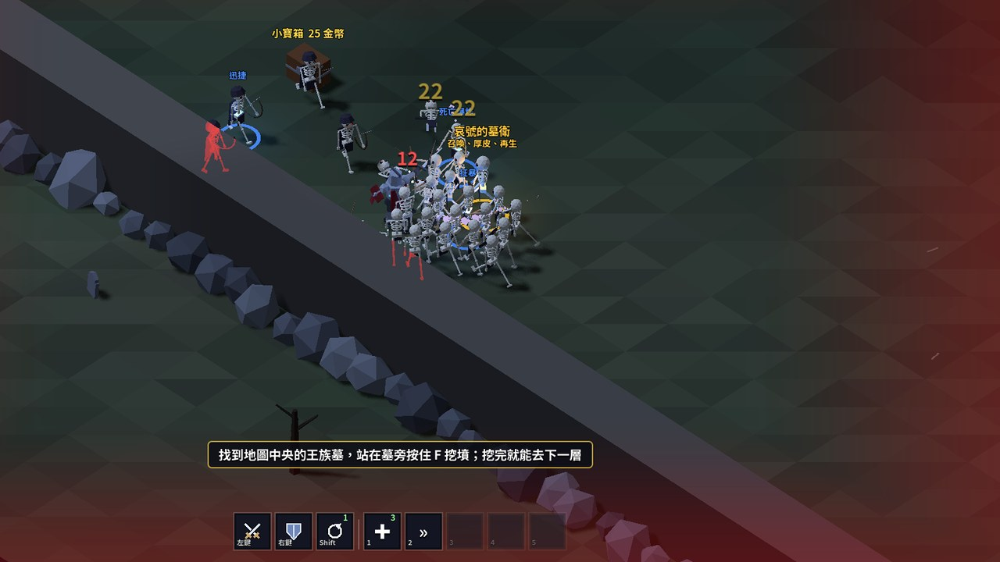

# Cubeborn（暫定名）

等距視角的 Roguelike 動作遊戲：在墓地裡割草清怪、開寶箱湊道具、挖開王族墓前往下一層。最多 4 人連線合作。用 Godot 4 開發，目前是試玩原型。

## 試玩
- **網頁版**：https://alex86106pig.github.io/Cubeborn/ ，用電腦的瀏覽器開，第一次載入要等一下。可以多人連線：Esc →「開房（網路）」，其他人輸入 4 碼房號加入。
- **Windows 版**：到 [Releases](https://github.com/alex86106pig/Cubeborn/releases) 下載最新的 `Cubeborn-vX.Y.Z-windows.zip`，解壓後執行 `Cubeborn.exe`。
- **和朋友連線**：見 [連線試玩說明](docs/連線試玩.md)（網頁版房號，或 Windows 版 + 虛擬區網）。網頁版和 Windows 版不能混著玩。

## 操作
| 按鍵 | 動作 |
|---|---|
| WASD | 移動 |
| 滑鼠 | 瞄準 |
| 左鍵 / 右鍵 | 攻擊 / 特殊技（劍盾的右鍵是格擋：按一下舉盾 3 秒，再按一下放下） |
| 空白鍵 | 跳躍 |
| Shift | 翻滾 |
| 1~5 | 使用道具 |
| F | 撿道具、開寶箱、挖墳；按住救援倒下的隊友 |
| Tab | 背包與屬性（拖曳擺放、R 旋轉、武器拖到武器上合成） |
| X / 滾輪 | 切換武器 |
| Esc | 選單（暫停、連線） |
| M / R | 靜音 / 重新開始 |

## 試玩回報
結算畫面按「複製遊玩紀錄」，貼到聊天軟體傳給作者（版本、打到哪、配裝、擊殺、受到的傷害、被誰打倒、FPS 與卡頓、連線延遲）；也請說哪裡卡住或不好玩。

## 版權
程式碼公開只供瀏覽，**版權所有、未經同意不得使用或散布**。字型 Noto Sans TC 依 SIL Open Font License 授權（見 `godot/assets/fonts/`）。
